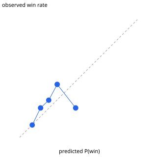

# Model card: win probability (v20261123130739)

_Generated by `python -m apex_agent.costing.win_model train` (S14). No LLM._

**Use:** P(win) of a quote at a given price, for the margin curve (advisory) and the queue priority. **Not for:** setting prices automatically (the engine prices; OPA enforces the margin floor and ceiling).

**Model:** logistic regression on 5 features: log_price_ratio, response_days, tier_A, tier_C, log_qty.

**Data:** Apex's decided quotes in Odoo, split by time. Train: 292 quotes (2023-12-04 to 2026-02-20, win rate 27.1%). Test: 98 quotes (2026-02-22 to 2026-11-15, win rate 27.6%).

**Result (test):** Brier 0.2038 vs 0.1996 for the average win rate (skill -2.1 %). Used: **NO: does not beat the baseline**.

| Bin | Quotes | Predicted | Observed |
|---|---|---|---|
| 1 | 19 | 10.7% | 10.5% |
| 2 | 20 | 17.8% | 25.0% |
| 3 | 19 | 24.7% | 31.6% |
| 4 | 20 | 31.9% | 45.0% |
| 5 | 20 | 47.6% | 25.0% |

**Coefficients (standardised):** log_price_ratio -0.157, response_days -0.485, tier_A +0.33, tier_C -0.178, log_qty +0.036

**Limits:** the reference price is today's engine (rates, routing, cycle-time model) with the supplier prices valid on each quote's date, not the spreadsheet Apex used then; competitors' prices are unknown; a small test set (one sample of the future), which was looked at during development (two feature fixes before the regularisation was chosen inside the training period); the model is retrained by hand (`train`), and it replaces the current one only when it beats the baseline.
