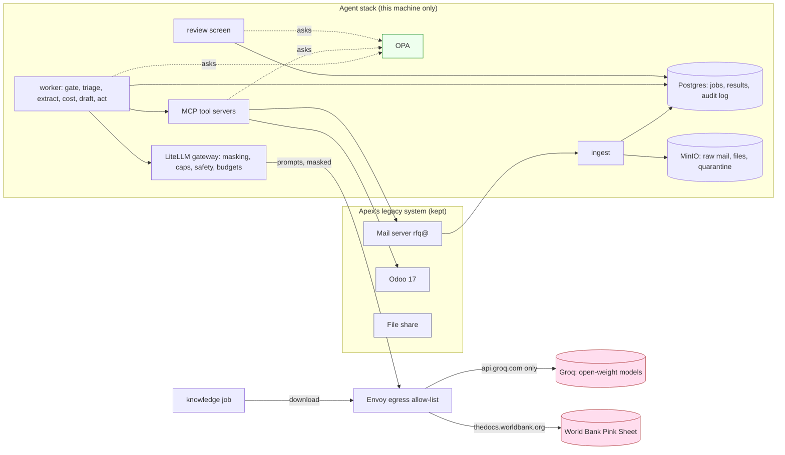

# Data flow: what leaves the box (S9)

Everything runs on one machine (Docker Compose). **Only two things leave it**, both through the Envoy egress allow-list:
prompts to **Groq** (through LiteLLM) and the monthly **World Bank** price file (a download). Nothing else can reach the
internet (S1 networks; red team 7 proves links in emails are never fetched).

| Data | Leaves the box? | To | What is removed first | Can it be kept local? |
|---|---|---|---|---|
| Email text, PDF/DXF text (for injection check, triage, requirements) | yes | Groq via LiteLLM | Email addresses, phone numbers, IBANs (gateway masking); hidden text stripped | Yes for export-controlled RFQs: `data_governance.keep_export_controlled_local: true` sends them to a person, no model call |
| Scanned drawing images | yes (only scans without CAD text) | Groq (vision) | — (max 3 pages; CAD files are read by code and never sent) | Same switch |
| Computed prices, dates, CO₂ (for the drafter) | yes | Groq | — | Same switch |
| Customer names, other customers' prices, Odoo data | no (only this job's facts go to the drafter) | — | — | — |
| Drawings, raw mail, Odoo records | no | stay in MinIO / Odoo | — | — |
| Traces and logs | no | Langfuse / Docker logs (local) | Presidio redaction (S3) | — |
| API keys and passwords | no | `.env` → containers' environment | — | — |
| World Bank price file | in only (download) | — | — | — |

**Retention** (`agent/config/policy.yaml -> retention`, `make retention`): graph checkpoints of finished jobs 30 days; quarantined files 30 days; raw mail stays on Apex's mail server; the audit log is never deleted. Langfuse keeps traces locally (its own retention is a paid feature; the traces are redacted).
