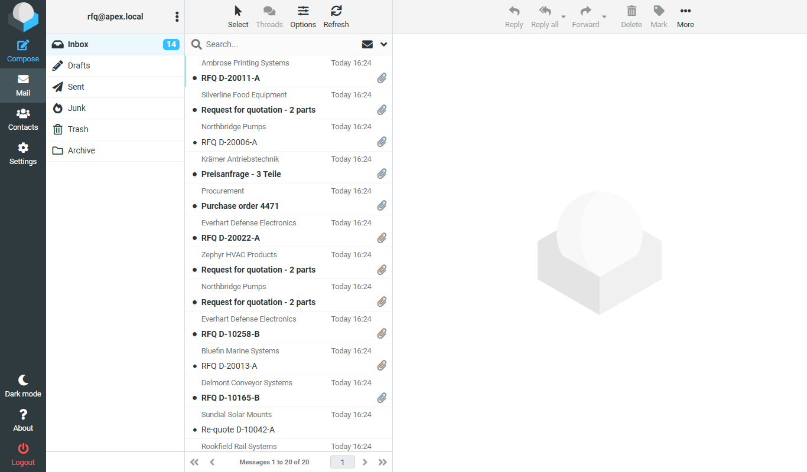
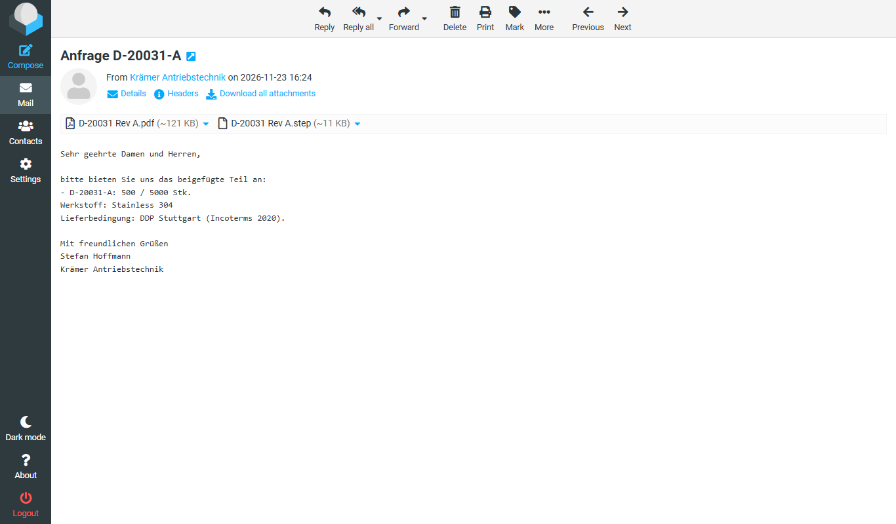
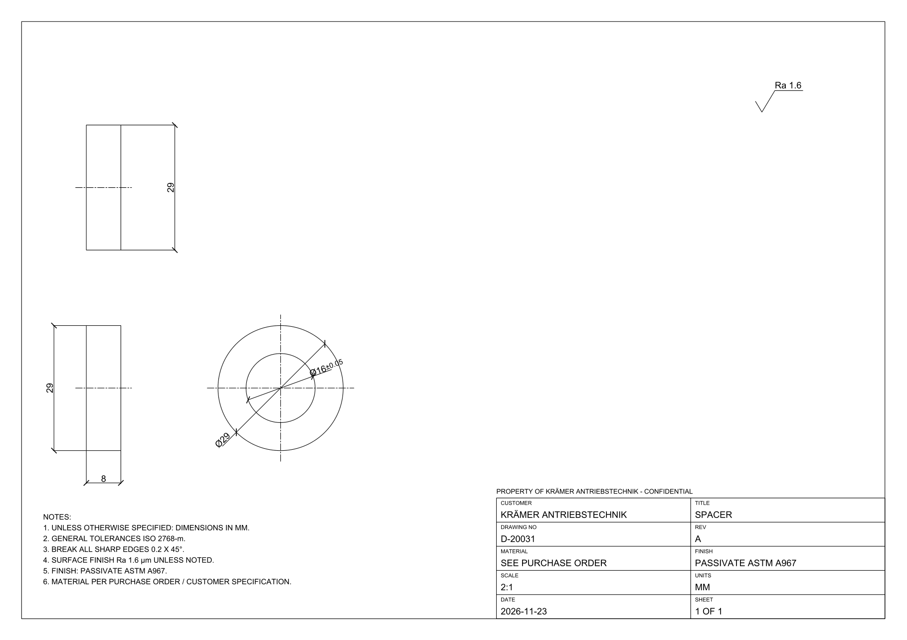
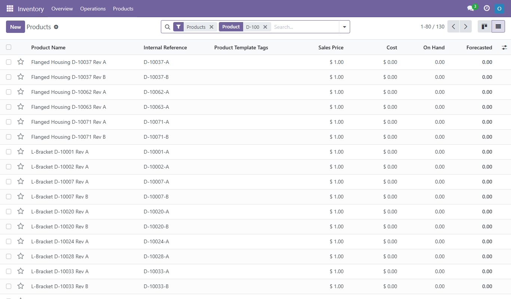
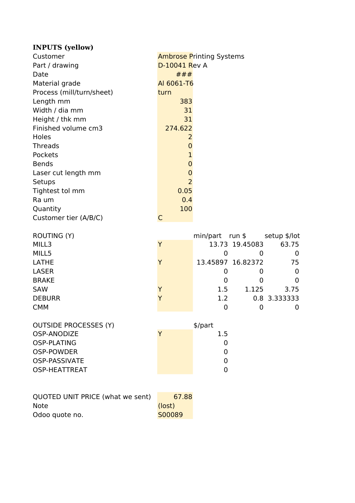
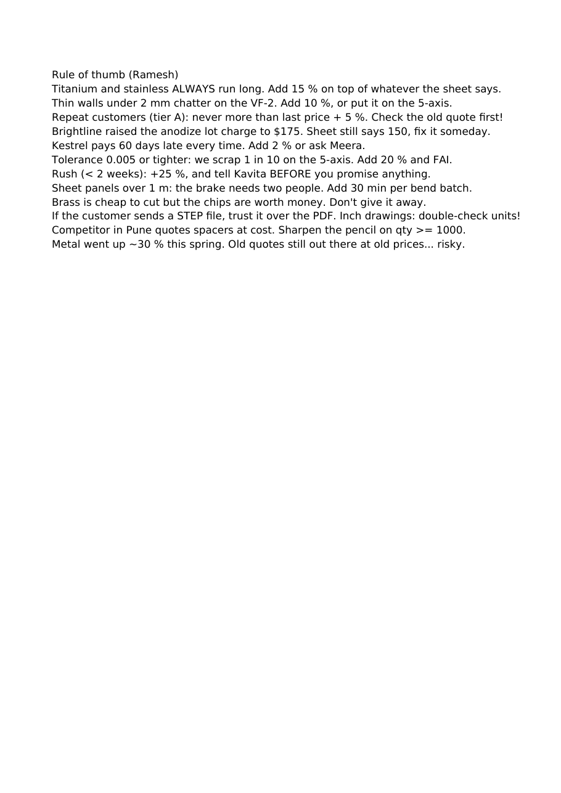
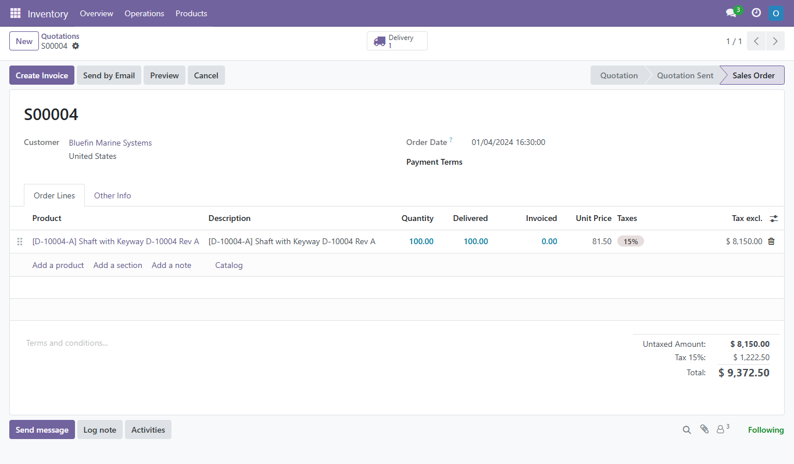
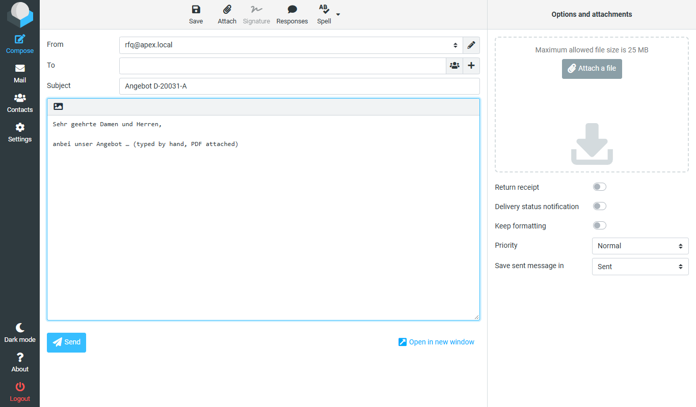
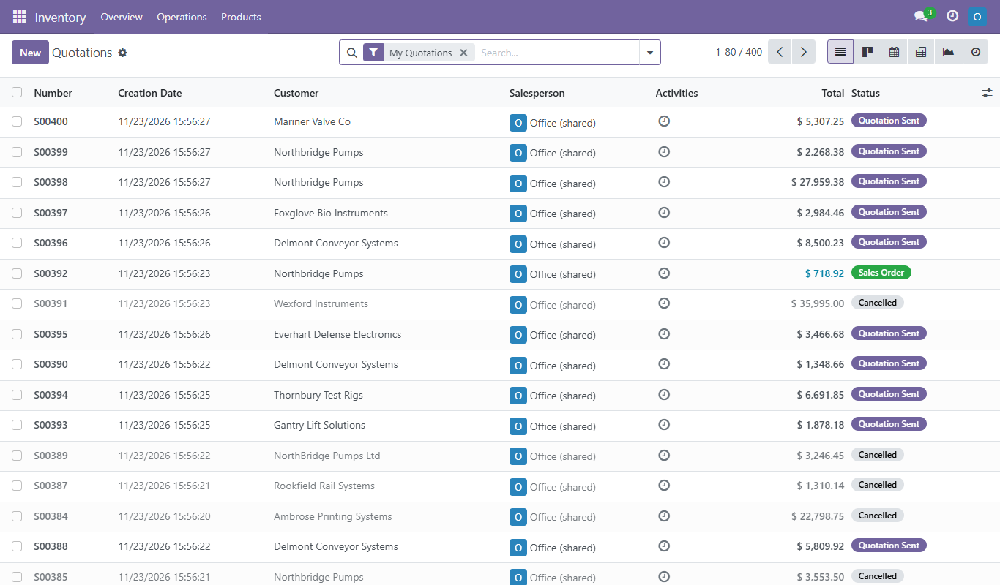

# SOP: how an Apex estimator quotes an RFQ today (manual, as-is)

> **What this is:** the procedure Arjun and Ramesh actually follow, written down by the FDE team while shadowing them (phase L6). Nobody at Apex had written it before. Screenshots are from the running legacy system (`uv run python -m scripts.screenshots`). Weakness IDs (W#) point to `PAIN_POINTS.md`; the measured results are in `BASELINE_METRICS.md`.
>
> **Typical effort:** about **2.5 hours of work per quote**, spread over **3–5 days** of waiting (measured median reply **5.0 days**). Students time themselves on three RFQs in `BASELINE_METRICS.md`.

**Logins used:** Roundcube `rfq@apex.local` (the one shared mailbox password, W3); Odoo `office` (the one shared login, W3); the file share with the one `fileshare` password (W16). Nobody can tell afterwards which estimator did what.

---

## Step 1: Pick the next email from the shared inbox
Open Roundcube (http://127.0.0.1:8081) as `rfq@` and take the **oldest** unanswered email. No ranking: a $200 000 repeat order waits behind a CV and a newsletter (**W1**). Skip anything that is clearly not an RFQ, but leave it there, because nobody owns the inbox.

## Step 2: Read the email and the drawing
Open the RFQ. Note the quantity breaks, the material (sometimes only in the email), the delivery wish, certificates (FAI, PPAP, 3.1), Incoterms and any CO₂ question. Then open the attached PDF (it may be a crooked scan, in inches, or two sheets) and read every dimension, tolerance, thread and finish **by eye**. German, Spanish or Hindi emails go to whoever can read them.

**Watch out:** a CO₂ footprint request can't be answered (**W15**). Parts no machine can make are only noticed if someone checks every tolerance and travel against the machine list (**W11**).

## Step 3: Look for similar parts in Odoo
Log in to Odoo as `office` → **Inventory → Products** and search by drawing number or family. If the part was quoted before, it is re-quoted **from scratch** anyway, and a new revision isn't linked to the old one (**W10**). Material names are typed many ways ("AL6061", "6061-T6", "Alu 6061"), and customers exist twice (**W4**).

## Step 4: Price it in the spreadsheet
Open `\\fileserver\Quotes\Pricing_Calculator_v7_FINAL(2).xlsx` (**not** `…_FINAL.xlsx`). Type the stock size, volume, features, setups, tolerance, finish, quantity and customer tier into the yellow cells, and tick the routing. The sheet's metal prices are from **2023** (**W5**).

## Step 5: Ask Ramesh, or apply his notes
Check the **Ramesh notes** sheet ("titanium always runs long, add 15 %", "Kestrel pays late, add 2 %"…) or walk over to Ramesh. Override the sheet's price by hand and write the reason as free text (**W6**).

## Step 6: Decide the delivery date
Write **"3 weeks"**. Nobody checks machine load or material lead time (**W7**); measured on-time delivery is about 70 %. Supplier prices for outside processes come from memory or a phone call (**W13**). If a subcontractor is needed, Tom forwards the customer's whole drawing (**W18**).

## Step 7: Type the quote into Odoo
**Sales → Quotations → New**: customer (pick the right one of the duplicates), product (create it if it is new), quantity, the unit price from the spreadsheet. Save. Odoo stamps a default 30-day expiry that nobody enforces (**W8**). Save the spreadsheet copy into `Customers\<name>\`, or forget to, so some quotes exist only in Excel (**W5**).

## Step 8: Email the quote
In Roundcube, **Compose** from `rfq@`, attach the PDF, write the price, quantity and "about 3 weeks", and send. No validity or price protection in the text (**W8**).

## Step 9: …and then nothing
No reminder, no follow-up, no win/loss review. If the customer says no, the reason is recorded for only about 1 in 5 lost quotes (**W9**). Nobody compares the quoted cost with the actual job cost afterwards (**W14**), and management sees no response-time or win-rate figures (**W17**).

